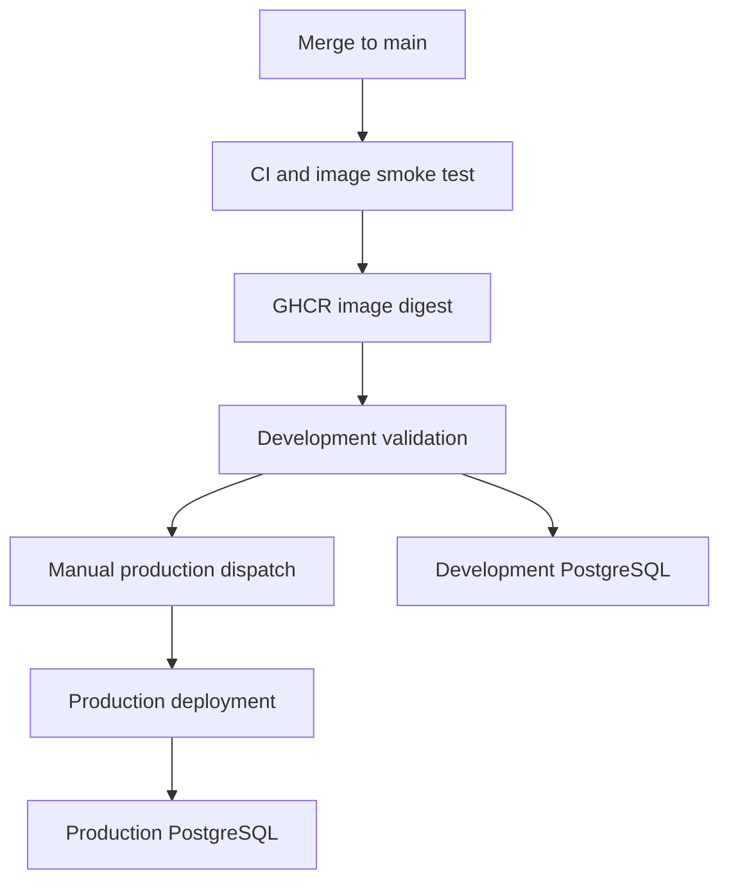

# Deployment and release

Fieldnote Atlas keeps its existing Vite SPA, FastAPI API, Alembic migrations and SQLAlchemy repositories. The release deployment uses two PostgreSQL 16 instances and one private monitoring network on a Docker host. It follows the lecture's development-first release flow using Compose and GHCR. [Lecture](https://aishippingblog.com/p/devops-and-observability-for-an-ai)



## Prepare the deployment host

Use a persistent Linux host with Docker Engine, Compose v2, Python 3, Git, curl, OpenSSL and flock. A machine you already control works. The host and GitHub Actions runner must remain online to deploy automatically. Use a private repository or a dedicated trusted runner limited to the deploy jobs on protected main. Never schedule pull request jobs on the deploy runner. Keep the Docker socket and runner access restricted to deployment operators.

1. Register a self-hosted runner with the additional label `atlas-deploy`. Create GitHub environments named `development` and `production`, limited to the main branch. Add a required production reviewer where supported. Default to GitHub's job token for GHCR and grant this repository access if the package was created separately.
2. Use the same host user as the runner to make the directory and credentials below. Fill files with independent generated passwords. Store them outside the checkout. Enter actual values in place of the angle-bracket placeholders.

   ```bash
   umask 077
   config="$HOME/.config/fieldnote-atlas"
   mkdir -p "$config"/{development,production}
   openssl rand -hex 32 > "$config/alert-token"
   # The responder and Alertmanager use different non-root UIDs.
   # The containing directory remains mode 700 on the host.
   chmod 0444 "$config/alert-token"
   docker network create atlas-monitoring
   ```

   `development/host.env` contains `APP_PORT=8000` and `DB_PASSWORD=<generated hex password>`. Set `APP_PORT=8001` and a different password in `production/host.env`. Use `openssl rand -hex 32` as the password generator so the database URL requires no percent encoding. Keep the env files mode 600. Each Compose project gets a distinct database volume and default database network.

3. Create `$config/monitoring.env` with `GRAFANA_ADMIN_PASSWORD=<generated password>` and `ALERT_TOKEN_FILE=<absolute path to alert-token>`. Add `OPENAI_API_KEY` to this file for live incident analysis. Start monitoring from the repository root.

   ```bash
   docker compose -p atlas-monitoring --env-file "$config/monitoring.env" -f observability/compose.yml up -d --build
   ```

4. In the host settings for any earlier Railway, Render, Vercel, or Pages deployment, disable automatic production deployment from main. The old GitHub Actions webhooks and Pages deploy have been removed. The Compose application ports bind to loopback. For remote access, use an SSH tunnel or a TLS reverse proxy appropriate to your host.
5. Merge this branch to main to run CI and deploy development. Confirm the development digest in `$config/development/current`. Visit the app and the dashboard before promoting. A production availability alert is expected until production starts.

## Promote and roll back

Trigger **Promote tested release** from the GitHub Actions tab on main. Enter the SHA-256 digest alone, including `sha256:`. The job locks development release state and checks the input against the successfully validated development digest. Production pulls that exact digest. No build runs on either deployment host job.

The release script waits for database and container health, reads the atlas API, and checks the environment and digest returned by `/api/version`. On a failed release it attempts to reapply the last verified image. For operator-initiated rollback, on the runner host with GHCR read access, run:

```bash
./deploy/release.sh production "$(cat "$HOME/.config/fieldnote-atlas/production/previous")"
```

The app and the database release are separate concerns. Before any schema-changing release take and verify an environment-specific PostgreSQL backup. Old code must remain compatible with the migrated schema for a digest rollback to work. For breaking migrations, rehearse database restoration with the affected image before promoting.

To validate isolation, compare `/api/version` on ports 8000 and 8001, then create a synthetic note in development and confirm its ID is absent from production's `/api/atlas`.

## GitHub issues

Run `python scripts/sync_github_issues.py --observability --dry-run` to review the issue plans. With repository issue permissions, run the same command without `--dry-run` and pass credentials through `GITHUB_TOKEN`. Reference the resulting issue numbers in the PR and post runtime evidence to each issue. Keep issues open until each acceptance criterion has been verified.
