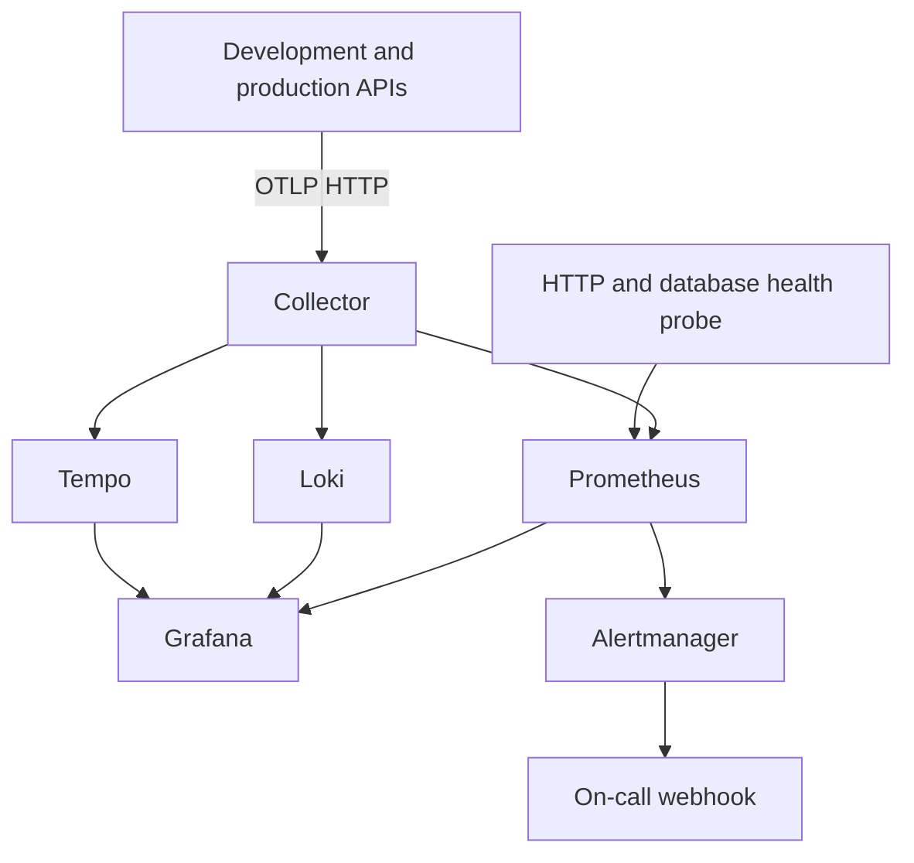

# Observability

Both APIs export service, environment and deployed digest. FastAPI and SQLAlchemy create request and database spans. Application logs attach the route template, status class and operation and carry the active trace ID. The dashboard uses separate counters for successful creation, successful star changes and server-side observation write failures. It also shows requests per second, server-error ratio, p95 request latency, API and database availability, and Collector health. Probe panels cover the selected environment independently of the version filter.

Dashboard URL on the deployment host is [Fieldnote Atlas Grafana](http://127.0.0.1:3000/d/fieldnote-atlas). Use Grafana Explore to verify Loki with `{service_name="fieldnote-atlas",deployment_environment_name="development"}` and Tempo with `{ resource.service.name = "fieldnote-atlas" && resource.deployment.environment.name = "development" }`. In Tempo expand a request span to view SQL spans. In Prometheus query `atlas_observations_created_total` after creating a note and `atlas_observation_star_changes_total` after toggling its star.

| Alert | Threshold | Hold time | Severity | Destination |
| --- | --- | --- | --- | --- |
| AtlasHighErrorRate | 5xx ratio > 10% over 2 minutes | 30s | warning | Alertmanager → on-call webhook |
| AtlasHighLatency | p95 > 750ms over 2 minutes | 30s | warning | Alertmanager → on-call webhook |
| AtlasUnavailable | HTTP/database probe fails or scrape is down | 30s | critical | Alertmanager → on-call webhook |
| AtlasObservationFailures | At least 3 server-side write failures over 2 minutes | 30s | warning | Alertmanager → on-call webhook |

## Development failure drill

1. Deploy development as instructed in [DEVOPS.md](DEVOPS.md). Open the app and Grafana. Create and star a synthetic note to check that business metrics rise. Verify all three signals using Explore.
2. On the deployment host run `python3 deploy/drill.py`. Set `ATLAS_DEV_PORT` if you chose a different port. The script enables a development-only local fault flag, sends real create requests that take around 1.2 seconds and return 503, confirms all three write-related rules fire, then clears the flag. It stops the development app briefly to exercise the probe alert and restarts it automatically. It waits for all development drill alerts to clear. Run this while development deploys are idle.
3. Confirm firing and resolved records in the incident database using [AI_ONCALL.md](AI_ONCALL.md). Save the real dashboard view, alert output and analyzed incident report as evidence. Create one more synthetic note to verify writes recovered.
4. Trigger a production promotion and verify version equality and database isolation as described in [DEVOPS.md](DEVOPS.md).

If a drill is interrupted, remove `/tmp/atlas-fault` in the development app with `docker exec` and rerun the development Compose startup, or run the release script with the existing development digest to restart the environment.
