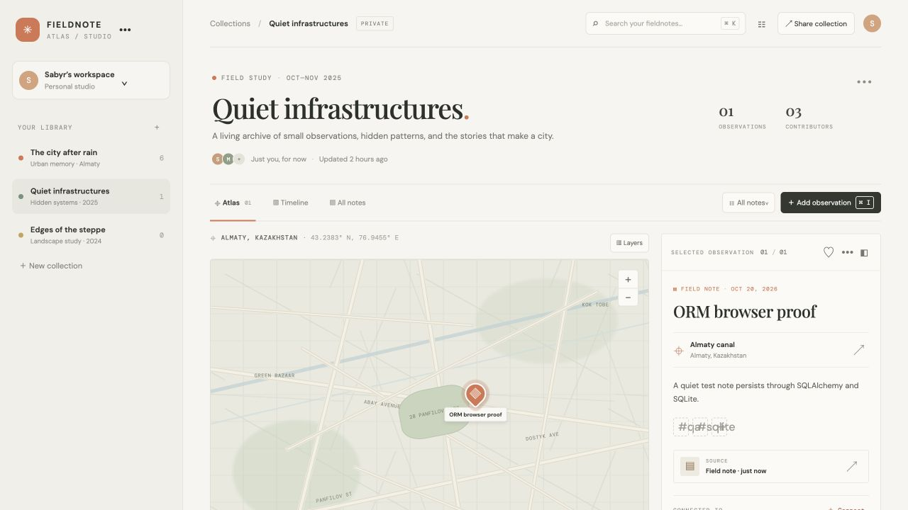

# Fieldnote Atlas

**A visual field-research archive for the details that make a place feel like itself.** Collect observations, interview fragments, artifacts, and signals; keep their sources and tags attached; explore the evidence on a map.



The map is a hand-composed Almaty study surface with selectable evidence pins, a fieldnote reader, and an editorial collection archive.

## Run locally

Requirement: Python 3.11+ and the packages in `backend/requirements.txt`. Use a virtual environment so the app and tests use the same dependencies.

```sh
python3 -m venv .venv
source .venv/bin/activate
python -m pip install -r backend/requirements.txt
python3 server.py
```

Open `http://127.0.0.1:8091/`. The canonical frontend talks to FastAPI, which uses SQLAlchemy with SQLite by default. Data persists in `fieldnote-atlas.sqlite3`; set `FIELDNOTE_DB_URL` to use another SQLAlchemy-supported database URL. Set `FIELDNOTE_REPOSITORY=memory` to run the in-memory API iteration. Open `/?mock=1` for the local mock-service iteration. API health and data are available at `/api/health` and `/api/atlas`.

Optional commands:

```sh
npm run dev
npm test
npm run build
```

`npm run dev` starts the same FastAPI application. The canonical frontend is `index.html`, `app.js`, and `style.css` at the repository root. There is one app entry point.

## Project map
- `backend/` — FastAPI; SQLAlchemy/SQLite default and in-memory workflow mode
- `openapi.yaml` — frontend/backend contract
- `docs/` — product spec, brainstorm, design brief, test/process guidance, backlog, role briefs

## Workflow
This project follows the staged path in `docs/process.md`: mock-backed frontend → OpenAPI contract → in-memory backend → SQLite through SQLAlchemy → integrated frontend/backend. The GitHub repository is [Sabyrzhan01/fieldnote-atlas](https://github.com/Sabyrzhan01/fieldnote-atlas). It has the `mvp`, `post-mvp`, and `user-test-bug` labels. Groomed issue bodies are stored under `issues/` and mirrored as GitHub issues.

## Status
The canonical SQLAlchemy/SQLite edition and mock iteration are verified. API checks cover seed, selected-collection create, invalid input, star, persistence, delete, and not-found. See `docs/qa-results.md` for commands and walkthrough evidence. GitHub issues track implementation and user-test bugs.
